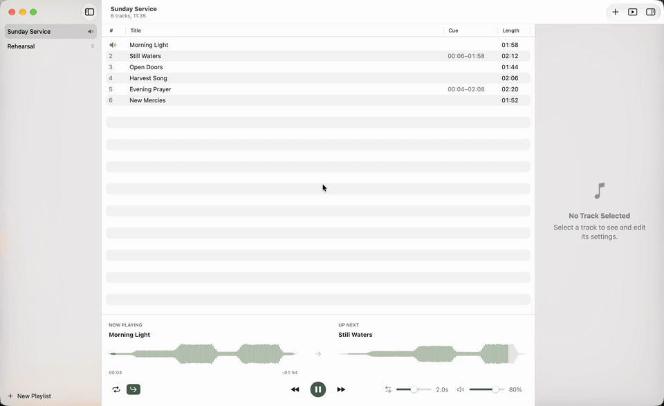
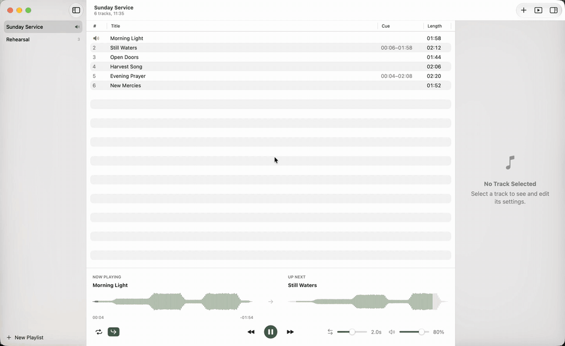
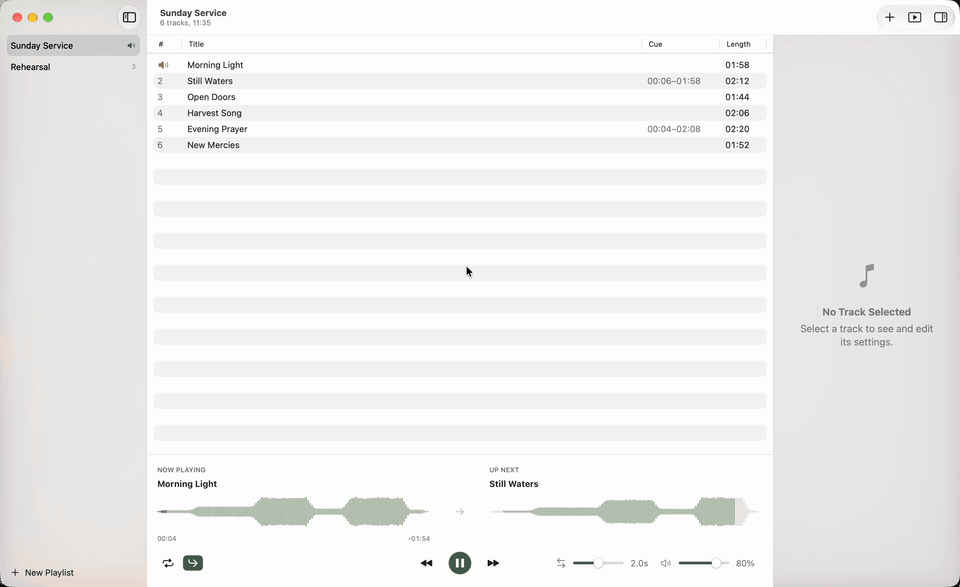
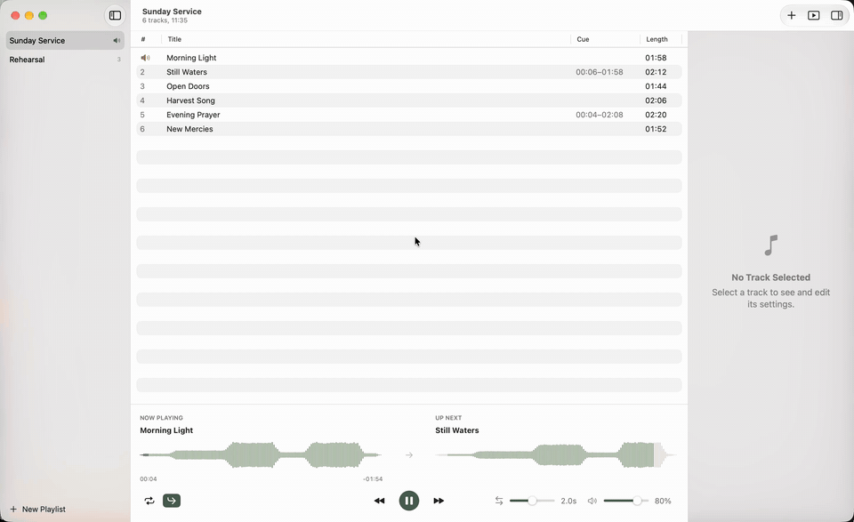
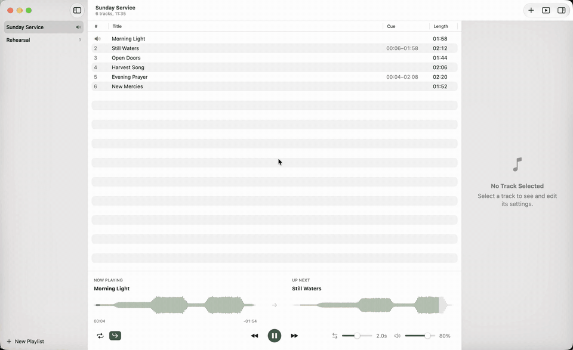
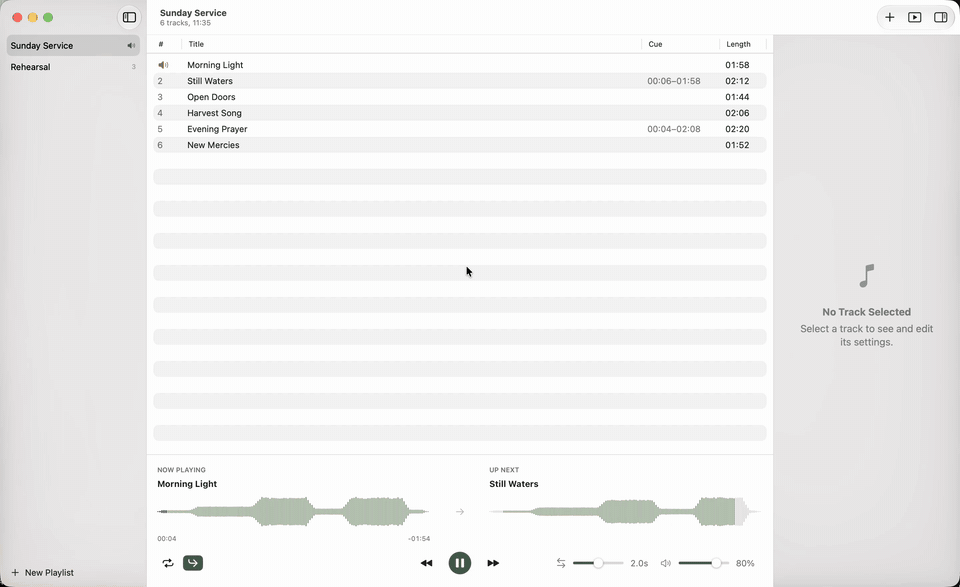
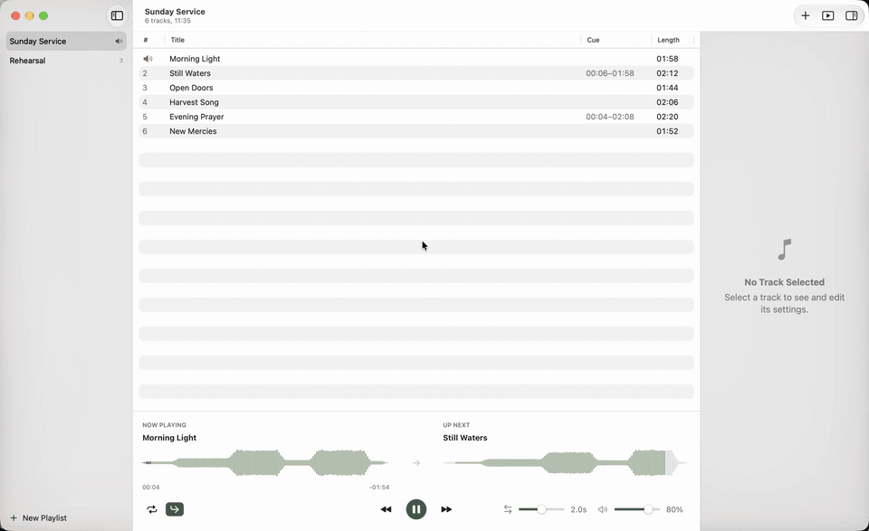

# Grace

A Mac music player for preparing playlists and running them with care. Set the right start and end for each track, balance its volume, and move smoothly into the next song.

**Download Grace 0.3.0:** [Apple silicon](https://github.com/youngkwangk/grace-player-downloads/releases/download/native-v0.3.0/Grace-0.3.0-arm64.zip) · [Intel](https://github.com/youngkwangk/grace-player-downloads/releases/download/native-v0.3.0/Grace-0.3.0-x86_64.zip) · [Release notes](https://github.com/youngkwangk/grace-player-downloads/releases/tag/native-v0.3.0) · [Watch the walkthrough](media/grace-walkthrough.gif) · [Report an issue](https://github.com/youngkwangk/grace-player-downloads/issues)

## Download and install

| Computer | Download |
| --- | --- |
| Mac with Apple silicon (M1 or later) | [Grace-0.3.0-arm64.zip](https://github.com/youngkwangk/grace-player-downloads/releases/download/native-v0.3.0/Grace-0.3.0-arm64.zip) |
| Mac with an Intel processor | [Grace-0.3.0-x86_64.zip](https://github.com/youngkwangk/grace-player-downloads/releases/download/native-v0.3.0/Grace-0.3.0-x86_64.zip) |

Open the ZIP and drag **Grace** to **Applications**. **Apple menu → About This Mac** shows your chip or processor. Grace needs macOS 14 Sonoma or later, and is signed and notarized by Apple.

**Coming from Music Player?** Grace opens the same playlists, cue points, track settings and playback position, with nothing to import. Use one app at a time: Music Player does not notice changes made in Grace, and its next save would replace them.

**On Windows?** Grace is Mac only. Music Player for Windows is in the [latest Music Player release](https://github.com/youngkwangk/grace-player-downloads/releases/latest) and keeps updating itself.

## Your first playlist

1. Click **New Playlist** at the bottom of the sidebar, then type its name.
2. Click **+** in the toolbar (or press **⌘O**) to add audio files or folders, or drag them from Finder onto the list. Supported formats: **MP3, AAC/M4A, WAV, AIFF and FLAC**.
3. Drag tracks to arrange the playing order.
4. Click a track to inspect it. Double-click a track to play it, crossfading from the one that is playing.
5. Watch **Now Playing** and **Up Next** at the bottom. Click the Now Playing waveform to jump within the current track; its darker part shows how far it has played.

Your playlists, cue points, track settings and playback position are saved as you go. Tracks stay where they are on disk, so keep those files available. If a file moves, the track is marked **File missing**: double-click it to locate the file again.

## See it in action

The walkthrough shows playback and crossfading, cue editing, track volume, the equalizer, YouTube import and keyboard help. It was recorded from the app with original demo music and example playlists.

## Prepare each track

### Choose where it starts and stops

Select a track to see it in the inspector on the right (show or hide it with the toolbar button). Under **Cue Points**, drag the handles to set where playback starts and stops, or type exact **Start** and **End** times such as `00:05.00`. **Reset** restores the full track.

### Balance volume and shape the sound

**Track Volume** adjusts one track from **0% to 200%**. Grace also measures each new track's loudness and levels it automatically; the adjustment is shown beside the heading. The volume slider at the bottom right sets overall playback.

Open **Parametric EQ** for five filter bands. Drag a point on the graph, or select a band and set its filter type, frequency, gain and Q. Each playlist item keeps its own settings, and every change can be undone with **⌘Z**.

## Control the flow

| Control | What it does |
| --- | --- |
| **Repeat** | Cycle between repeat off, repeat the playlist, and repeat one track. |
| **Auto Advance** | Continue to the next track, or stop after the current one. |
| **Crossfade** | Set the overlap between tracks from **0 to 4 seconds**. |
| **Previous / Next** | Move between tracks, crossfading. |
| **Now Playing / Up Next** | See the current and upcoming tracks with their waveforms. |

Right-click a track or playlist for more actions, including renaming and duplicating. Duplicate a track when you want a different cue range or sound settings for another occurrence of the same audio.

## Add audio from YouTube

Click the YouTube button in the toolbar (or press **⇧⌘O**), paste a video or playlist link, and choose what to download. Downloads appear in the playlist with progress and can be cancelled; the audio is saved in your Music folder. Grace includes everything it needs and keeps its YouTube downloader up to date by itself. If a download fails, it updates the downloader and tries once more; **File → Update YouTube Downloader** updates it on demand.

## Keyboard shortcuts

| Action | Keys |
| --- | --- |
| Play / pause | Space |
| Previous / next track | ← / → |
| Seek backward / forward 5 seconds | ⌘ ← / ⌘ → |
| Volume up / down 5% | ↑ / ↓ |
| Add files | ⌘ O |
| Add from YouTube | ⇧ ⌘ O |
| Undo / redo | ⌘ Z / ⇧ ⌘ Z |
| Show keyboard help | ? |

Playback shortcuts are suspended while you are typing in a text box.

## Appearance

**Grace → Settings…** (⌘,) sets the theme: Match System, Light or Dark.

## Updates

Grace checks for updates every six hours, and on **Grace → Check for Updates…**. When one is available it shows what's new, and downloads and installs it only if you choose to; Grace then restarts with your session restored. Keep Grace in Applications so it can update itself.

## Help and feedback

[Open an issue](https://github.com/youngkwangk/grace-player-downloads/issues) with your Grace version (**Grace → About Grace**), your macOS version, and the steps that led to the problem. A screenshot helps explain what happened.

This repository hosts the official downloads, update feeds, release notes and this guide. Application source and development history are kept in separate private repositories.
