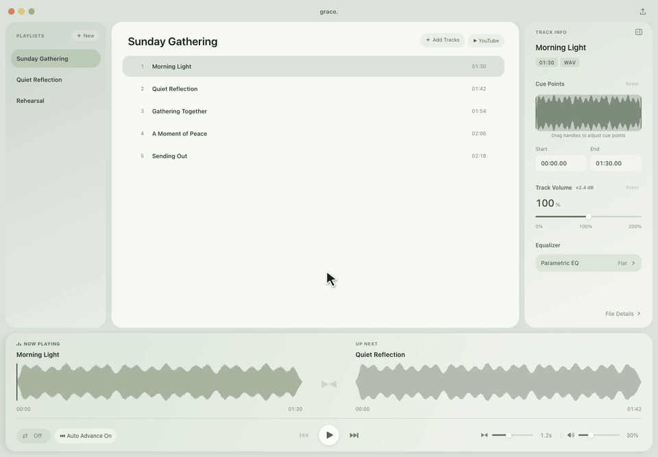
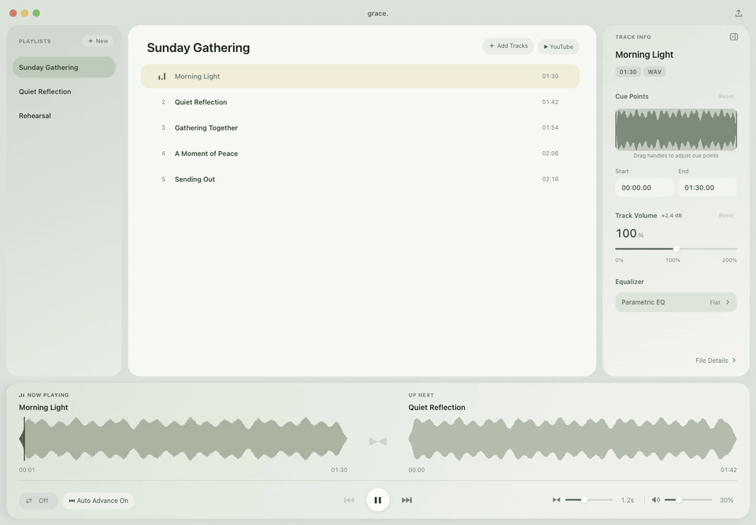
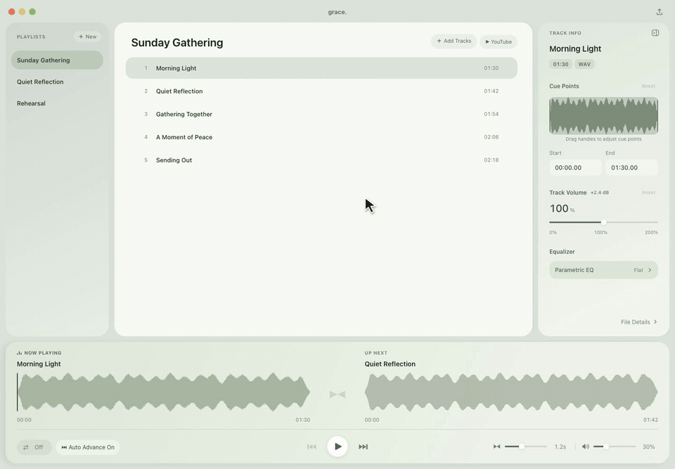
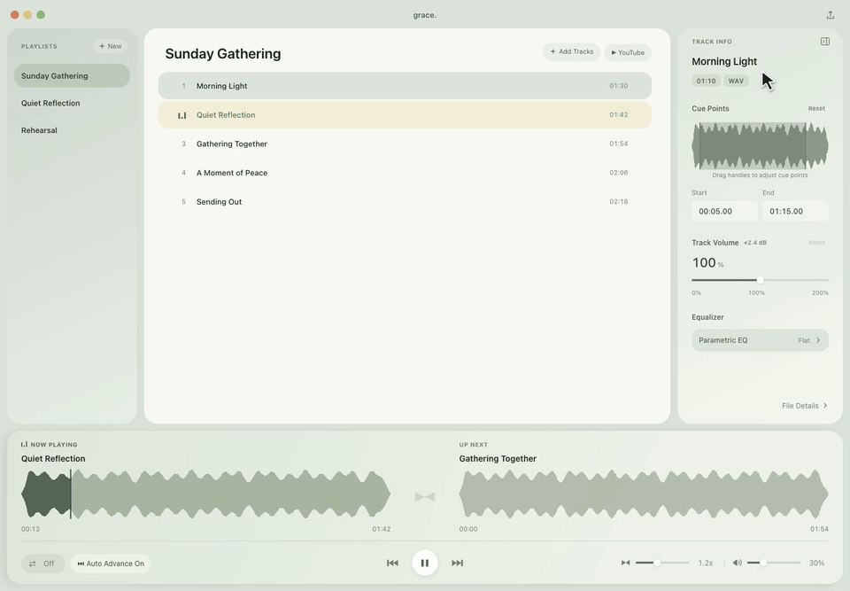
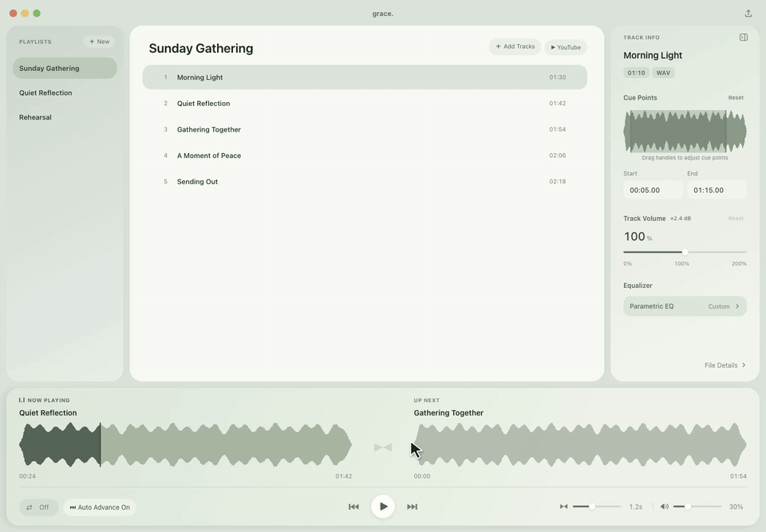
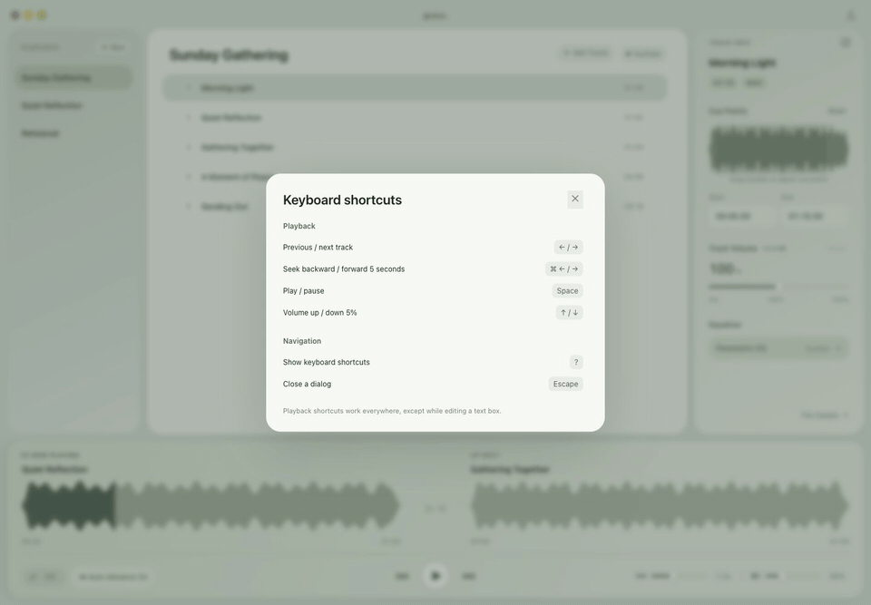

# Grace Music Player

A desktop music player for preparing playlists and running them with care. Set the right start and end for each track, balance its volume, and move smoothly into the next song.

**[Download the latest release](https://github.com/youngkwangk/grace-player-downloads/releases/latest)** · [Watch the walkthrough](media/grace-player-walkthrough.gif) · [Report an issue](https://github.com/youngkwangk/grace-player-downloads/issues)

## Download and install

Choose your download from the **Assets** section of the [latest release](https://github.com/youngkwangk/grace-player-downloads/releases/latest).

| Computer | Download | Installation |
| --- | --- | --- |
| Mac with Apple Silicon (M1 or later) | `arm64` Mac `.dmg` | Open the disk image and drag **Music Player** to **Applications**. |
| Mac with an Intel processor | `x64` Mac `.dmg` | Open the disk image and drag **Music Player** to **Applications**. |
| Windows, 64-bit | Windows `.exe` installer | Run the installer. This version supports in-app updates. |
| Windows, portable | Windows `.zip` | Extract the ZIP and run the app. Update this version manually. |

On a Mac, **Apple menu → About This Mac** shows your chip or processor. Mac release builds are signed and notarized. Windows builds are currently unsigned.

## Your first playlist

1. Click **New** in the left sidebar to create a playlist, then give it a name.
2. Click **Add Tracks** to choose local audio files. Supported formats: **MP3, FLAC, AAC, WAV, and OGG**.
3. Drag tracks by their handles to arrange the playing order.
4. Click a track to inspect it. Double-click a track to start playback, or use the **Play** button.
5. Watch **Now Playing** and **Up Next** at the bottom. Click the Now Playing waveform to seek within the current track.

Your playlists, cue points, track settings, and playback position are saved between sessions. Local tracks stay in their original locations; keep those files available. If a file moves, use **Locate file** on the missing track to reconnect it.

## See it in action

**[Open the complete animated walkthrough](media/grace-player-walkthrough.gif)**

The walkthrough shows playback, cue editing, the equalizer, moving to the next track, switching playlists, YouTube import, and keyboard help. Captured from the Mac app using original demo audio and example playlists. All demos are looping animated GIFs with a visible mouse pointer and click highlights.

## Prepare each track

### Choose where it starts and stops

Select a track to open **Track Info**. Under **Cue Points**, drag the waveform handles or enter a **Start** and **End** time, such as `00:05.00` and `01:15.00`. The player uses that section of the track. Click **Reset** to restore the full duration.

### Balance volume and shape the sound

Use **Track Volume** to adjust an individual track from **0% to 200%**. The app also analyzes tracks for loudness normalization; the adjustment appears beside the track-volume heading. The main volume control adjusts overall playback.

Open **Parametric EQ** in Track Info for five independent filter bands. Select a band, choose its filter type, and adjust frequency, gain where applicable, and Q. Each playlist item keeps its own EQ settings.

## Control the flow

| Control | What it does |
| --- | --- |
| **Auto Advance** | Continue to the next track automatically, or stop after the current track. |
| **Repeat** | Cycle between repeat off, repeat one track, and repeat the playlist. |
| **Crossfade** | Set the overlap between tracks from **0 to 3 seconds**. |
| **Previous / Next** | Move between tracks using the transport controls. |
| **Now Playing / Up Next** | See the current and upcoming tracks with their waveforms. |

Right-click a track or playlist for more actions, including renaming and duplicating. Duplicate a track when you want a different cue range or sound settings for another occurrence of the same audio.

## Add audio from YouTube

Click **YouTube** above the track list. Choose a video or playlist, paste its link, and follow the import prompts. Downloads appear in the playlist with progress and cancellation controls, and the downloaded audio is saved in your Music folder. Packaged apps include the download tools.

## Keyboard shortcuts

| Action | Mac | Windows |
| --- | --- | --- |
| Play / pause | Space | Space |
| Previous / next track | ← / → | ← / → |
| Seek backward / forward 5 seconds | ⌘ ← / ⌘ → | Ctrl ← / Ctrl → |
| Volume up / down 5% | ↑ / ↓ | ↑ / ↓ |
| Show keyboard help | ? | ? |
| Close a dialog | Escape | Escape |

Playback shortcuts are suspended while you are editing a text box.

## Updates

Use **Updates** in the title bar to check for a newer version. Choose to download it, then pause or stop playback and select **Restart to update**. The app saves the session before restarting. Update checks do not automatically download or install anything.

Mac users should run the app from Applications. Windows users need the `.exe` installer for in-app updates; portable ZIP users should download new versions manually. Versions before **2.4.1** need one manual update to switch to this public update feed.

## Help and feedback

[Open an issue](https://github.com/youngkwangk/grace-player-downloads/issues) with your app version, operating system, and the steps that led to the problem. A screenshot helps explain what happened.

This repository hosts official installers, update manifests, checksums, release notes, and this guide. Application source and development history are maintained in a separate private repository.
